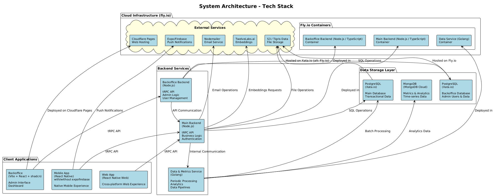
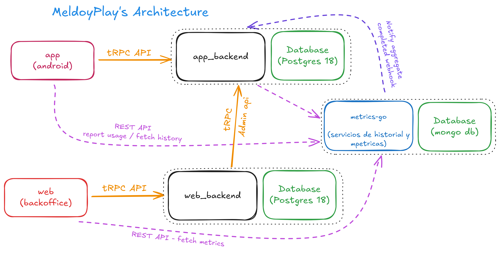
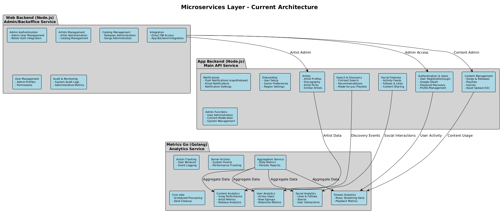

#+TITLE: Trabajo Práctico: Melodia - Grupo 2
#+OPTIONS: toc:t num:t
#+HTML_HEAD: <link rel="stylesheet" type="text/css" href="assets/theme/readtheorg_theme/css/htmlize.css"/>
#+HTML_HEAD: <link rel="stylesheet" type="text/css" href="assets/theme/readtheorg_theme/css/readtheorg.css"/>
#+HTML_HEAD: <link rel="stylesheet" type="text/css" href="assets/theme/readtheorg_theme/css/search.css"/>
#+HTML_HEAD: 
#+HTML_HEAD: 
#+HTML_HEAD: 
#+HTML_HEAD: 
#+HTML_HEAD: 

#+BEGIN_EXPORT latex
\begin{titlepage}
    \hfill\includegraphics[width=6cm]{assets/logofiuba.jpg}
    \centering
    \vfill
    \Huge \textbf{Trabajo Práctico: Melodia}
    \vskip0.5cm
    \Large \textbf{Grupo 2}
    \vskip2cm
    \Large [TA049] Ingenieria de Software II \\
    Segundo cuatrimestre de 2025\\
    \vfill
    \begin{tabular}{ | l | l | l | }
      \hline
      Alumno & Padrón & Email \\ \hline
      BRZOZA, Valeria & 107523 & vbrzoza@fi.uba.ar \\ \hline
      CICHERO, Tomas & 107973 & tcichero@fi.uba.ar  \\ \hline
      CONTRERAS VILLARROEL, Ricardo Luis & 107239 & rcontreras@fi.uba.ar \\ \hline
      DEALBERA, Pablo Andres & 106858 & pdealbera@fi.uba.ar \\ \hline
      LANZILLOTTA, Valentina & 108257 & vlanzillotta@fi.uba.ar \\ \hline
      MAKKOS, Juan Sebastian & 106229 & jmakkos@fi.uba.ar \\ \hline
    \end{tabular}
    \vfill
\end{titlepage}
\renewcommand{\contentsname}{Índice}
\tableofcontents
\newpage
\definecolor{bg}{rgb}{0.95,0.95,0.95}
#+END_EXPORT

* Architecture Diagram

#+BEGIN_SRC plantuml :file assets/arch-1.png :exports results
@startuml
!theme plain
skinparam componentStyle rectangle
skinparam backgroundColor white
skinparam component {
    BackgroundColor lightblue
    BorderColor black
    FontSize 12
}
skinparam database {
    BackgroundColor lightgreen
    BorderColor black
}
skinparam cloud {
    BackgroundColor lightyellow
    BorderColor black
}
skinparam direction top to bottom

title System Architecture - Tech Stack

' Top Layer - Cloud Infrastructure
package "Cloud Infrastructure (fly.io)" {
    cloud "External Services" {
        component [TwelveLabs.ai\nEmbeddings] as embeddings
        component [S3 / Tigris Data\nFile Storage] as storage
        component [Expo/Firebase\nPush Notifications] as expofirebase
        component [Nodemailer\nEmail Service] as email
        component [Cloudflare Pages\nWeb Hosting] as cloudflare
    }

    package "Fly.io Containers" {
        component [Main Backend (Node.js / TypeScript) \nContainer] as maincontainer
        component [Backoffice Backend (Node.js / TypeScript) \nContainer] as backofficecontainer
        component [Data Service (Golang)\nContainer] as datacontainer
    }
}

' Database Layer
package "Data Storage Layer" {
    database [PostgreSQL\n(Xata.io)\n\nMain Database\nTransactional Data] as postgres
    database [PostgreSQL\n(Xata.io)\n\nBackoffice Database\nAdmin Users & Data] as backofficedb
    database [MongoDB\n(MongoDB Cloud)\n\nMetrics & Analytics\nTime-series Data] as mongo
}

' Backend Services Layer
package "Backend Services" {
    component [Main Backend\n(Node.js)\n\ntRPC API\nBusiness Logic\nAuthentication] as mainbackend
    component [Backoffice Backend\n(Node.js)\n\ntRPC API\nAdmin Logic\nUser Management] as backofficebackend
    component [Data & Metrics Service\n(Golang)\n\nPeriodic Processing\nAnalytics\nData Pipelines] as dataservice
}

' Client Applications Layer
package "Client Applications" {
    component [Mobile App\n(React Native)\nwith/without expofirebase\n\nNative Mobile Experience] as mobile
    component [Web App\n(React Native Web)\n\nCross-platform Web Experience] as web
    component [Backoffice\n(Vite + React + shadcn)\n\nAdmin Interface\nDashboard] as backoffice
}

' Connections
mobile -up-> mainbackend : tRPC API
web -up-> mainbackend : tRPC API
backoffice -up-> backofficebackend : tRPC API

mainbackend -up-> postgres : SQL Operations
backofficebackend -up-> backofficedb : SQL Operations
dataservice -up-> mongo : Analytics Data
dataservice -up-> postgres : Batch Processing

mainbackend -up-> maincontainer : Deployed in
backofficebackend -up-> backofficecontainer : Deployed in
dataservice -up-> datacontainer : Deployed in
backoffice -up-> cloudflare : Deployed on Cloudflare Pages

postgres -up-> storage : Hosted on Xata.io (alt: Fly.io)
backofficedb -up-> storage : Hosted on Fly.io

mainbackend -up-> storage : File Operations
mainbackend -up-> embeddings : Embeddings Requests
mainbackend -up-> email : Email Operations
mobile -up-> expofirebase : Push Notifications

' Internal service communication
mainbackend --> dataservice : Internal Communication
backofficebackend --> mainbackend : API Communication

@enduml
#+END_SRC

#+RESULTS:

** Arquitectura General (Excalidraw)

#+CAPTION: Diagrama de arquitectura general creado con Excalidraw
#+NAME: fig:arch-excalidraw

** Microservicios

#+BEGIN_SRC plantuml :file assets/arch-microservices.png :exports results
@startuml
!theme plain
skinparam componentStyle rectangle
skinparam backgroundColor white
skinparam component {
    BackgroundColor lightblue
    BorderColor black
    FontSize 10
}
skinparam package {
    BackgroundColor lightgray
    BorderColor black
}

title Microservices Layer - Current Architecture

package "App Backend (Node.js)\nMain API Service" {
    component [Authentication & Users\n- User Registration/Login\n- Google OAuth\n- Password Recovery\n- Profile Management] as auth
    component [Artists\n- Artist Profiles\n- Discography\n- Artist Picks\n- Similar Artists] as artists
    component [Content Management\n- Songs & Releases\n- Playlists\n- Genres\n- Asset Upload (S3)] as content
    component [Social Features\n- Activity Feeds\n- Follows & Likes\n- Content Sharing] as social
    component [Search & Discovery\n- Full-text Search\n- Recommendations\n- Made-for-you Playlists] as discovery
    component [Notifications\n- Push Notifications (expofirebase)\n- Email Notifications\n- Notification Settings] as notifications
    component [Onboarding\n- User Setup\n- Genre Preferences\n- Region Settings] as onboarding
    component [Admin Functions\n- User Administration\n- Content Moderation\n- System Management] as admin
}

package "Web Backend (Node.js)\nAdmin/Backoffice Service" {
    component [Admin Authentication\n- Admin User Management\n- Better Auth Integration] as webauth
    component [Artists Management\n- Artist Administration\n- Catalog Management] as webartists
    component [Catalog Management\n- Releases Administration\n- Songs Administration] as webcatalog
    component [User Management\n- Admin Profiles\n- Permissions] as webusers
    component [Audit & Monitoring\n- System Audit Logs\n- Administrative Metrics] as webaudit
    component [Integration\n- Direct DB Access\n- App Backend Integration] as webintegration
}

package "Metrics Go (Golang)\nAnalytics Service" {
    component [Stream Analytics\n- Music Streaming Data\n- Playback Metrics] as streammetrics
    component [User Analytics\n- Active Users\n- New Signups\n- Retention Metrics] as usermetrics
    component [Content Analytics\n- Song Performance\n- Artist Metrics\n- Release Analytics] as contentmetrics
    component [Social Analytics\n- Likes & Follows\n- Shares\n- User Interactions] as socialmetrics
    component [Action Tracking\n- User Behavior\n- Event Logging] as actiontracking
    component [Aggregation Service\n- Daily Metrics\n- Periodic Reports] as aggregation
    component [Server Actions\n- System Events\n- Performance Tracking] as serveractions
    component [Cron Jobs\n- Scheduled Processing\n- Data Cleanup] as cronjobs
}

' Service Communication
auth --> streammetrics : User Activity
artists --> contentmetrics : Artist Data
content --> streammetrics : Content Usage
social --> socialmetrics : Social Interactions
discovery --> usermetrics : Discovery Events

webintegration --> auth : Admin Access
webintegration --> artists : Artist Admin
webintegration --> content : Content Admin

aggregation --> streammetrics : Aggregate Data
aggregation --> usermetrics : Aggregate Data
aggregation --> contentmetrics : Aggregate Data
aggregation --> socialmetrics : Aggregate Data

@enduml
#+END_SRC

#+RESULTS:

* App Backend

** Objetivo

** Stack

Librerías y tecnologías:

** Código, organización y testing

** Deployment

** Test Coverage

** CI/CD

* Web Backend

** Objetivo

** Stack

* Mobile App

* Features

*** Lecciones aprendidas principales

