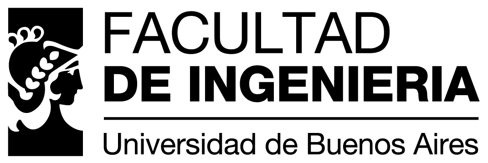

#+TITLE: Trabajo Práctico: Melodia - Grupo 2
#+OPTIONS: toc:t num:t
#+HTML_HEAD: <link rel="stylesheet" type="text/css" href="assets/theme/readtheorg_theme/css/htmlize.css"/>
#+HTML_HEAD: <link rel="stylesheet" type="text/css" href="assets/theme/readtheorg_theme/css/readtheorg.css"/>
#+HTML_HEAD: <link rel="stylesheet" type="text/css" href="assets/theme/readtheorg_theme/css/search.css"/>
#+HTML_HEAD: 
#+HTML_HEAD: 
#+HTML_HEAD: 
#+HTML_HEAD: 
#+HTML_HEAD: 

* Portada

** Integrantes
    Makkos Juan Sebastian
Plantilla base del informe. Completa el contenido de a poco.

* Introduccion
[Mock] Escribe aqui una descripcion general del proyecto, contexto y alcance.

* Objetivo
[Mock] Define objetivos funcionales y no funcionales del trabajo practico.

* Arquitectura
[Mock] Agrega una vista general de la arquitectura.

** Componentes
- [Mock] Frontend
- [Mock] Backend
- [Mock] Base de datos
- [Mock] Servicios externos

** Diagrama
[Mock] Inserta tu diagrama cuando lo tengas.

* Modulos
[Mock] Explica cada modulo principal y su responsabilidad.

* Features
[Mock] Lista funcionalidades clave y resumen de implementacion.

** Feature 1
[Mock] Problema, solucion y detalles tecnicos.

** Feature 2
[Mock] Problema, solucion y detalles tecnicos.

* Deploy y CI/CD
[Mock] Pipeline, ambientes y estrategia de despliegue.

* Problemas y Lecciones
[Mock] Problemas encontrados, mitigaciones y aprendizajes.

* Conclusion
[Mock] Cierre del informe y mejoras futuras.
