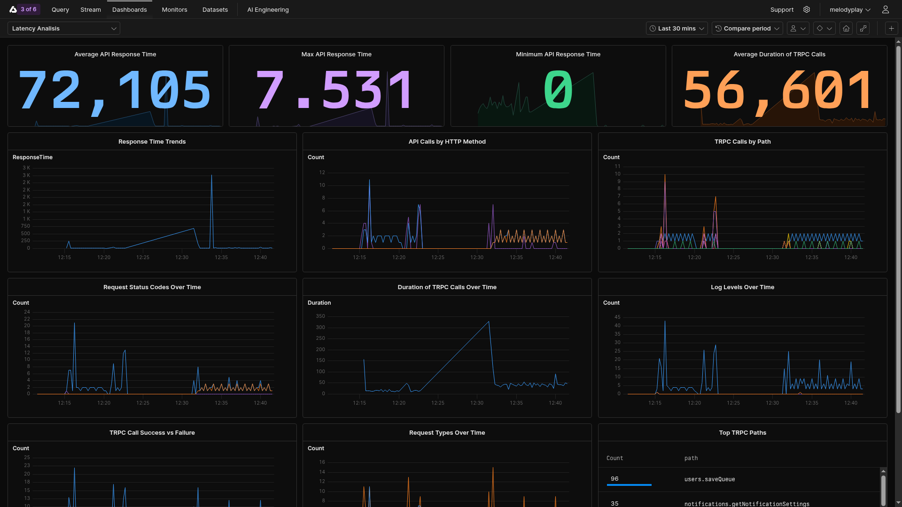
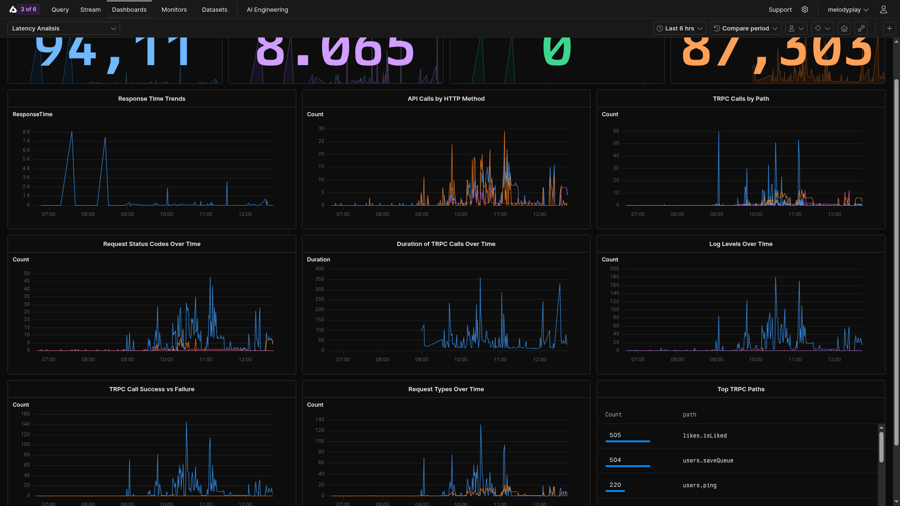
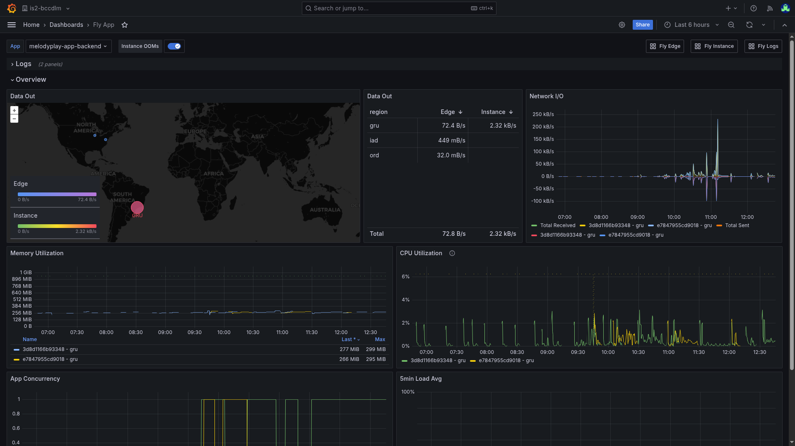
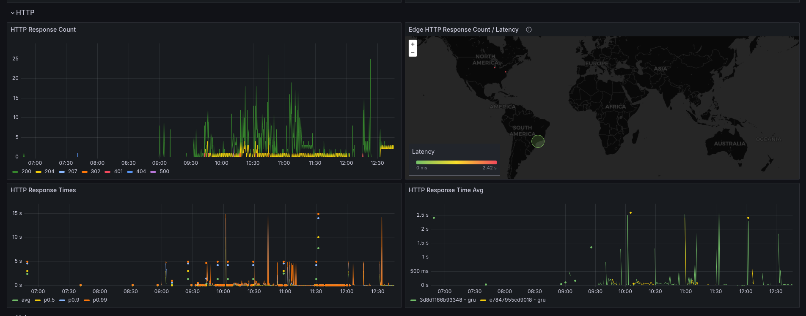
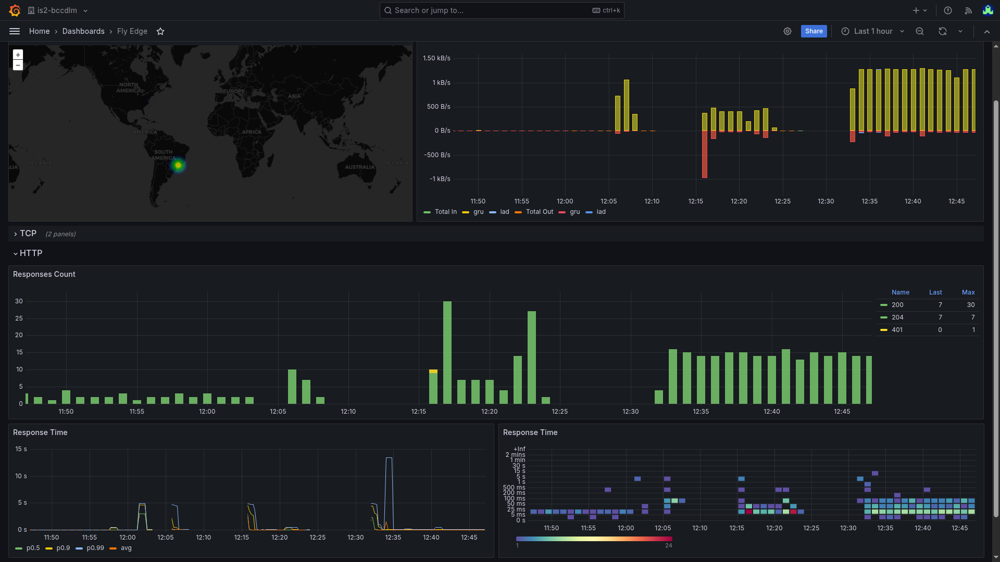
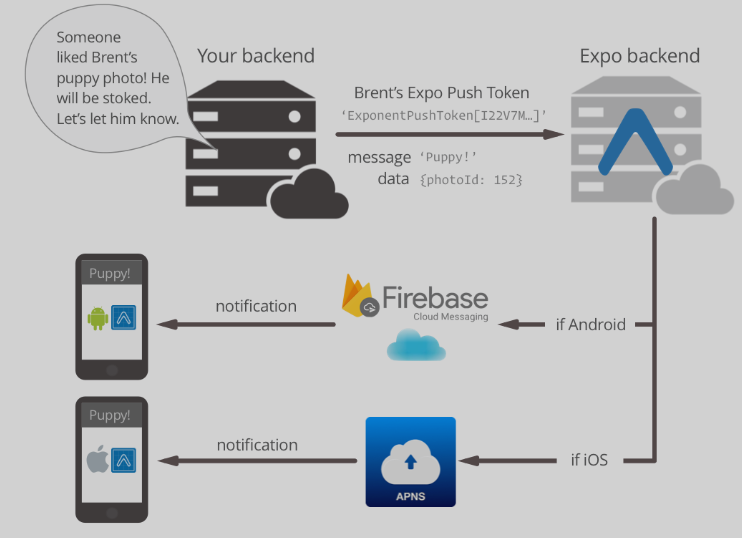

#+TITLE: Trabajo Práctico: Melodia - Grupo 2
#+SETUPFILE: ./org/theme-readtheorg.setup
#+SETUPFILE: ./org/setup.org

#+BEGIN_EXPORT latex
\begin{titlepage}
    \hfill\includegraphics[width=6cm]{assets/logofiuba.jpg}
    \centering
    \vfill
    \Huge \textbf{Trabajo Práctico: Melodia}
    \vskip0.5cm
    \Large \textbf{Grupo 2}
    \vskip2cm
    \Large [TA049] Ingenieria de Software II \\
    Segundo cuatrimestre de 2025\\
    \vfill
    \begin{tabular}{ | l | l | l | }
      \hline
      Alumno & Padrón & Email \\ \hline
      BRZOZA, Valeria & 107523 & vbrzoza@fi.uba.ar \\ \hline
      CICHERO, Tomas & 107973 & tcichero@fi.uba.ar  \\ \hline
      CONTRERAS VILLARROEL, Ricardo Luis & 107239 & rcontreras@fi.uba.ar \\ \hline
      DEALBERA, Pablo Andres & 106858 & pdealbera@fi.uba.ar \\ \hline
      LANZILLOTTA, Valentina & 108257 & vlanzillotta@fi.uba.ar \\ \hline
      MAKKOS, Juan Sebastian & 106229 & jmakkos@fi.uba.ar \\ \hline
    \end{tabular}
    \vfill
\end{titlepage}
\renewcommand{\contentsname}{Índice}
\tableofcontents
\newpage
\definecolor{bg}{rgb}{0.95,0.95,0.95}
#+END_EXPORT

* Architecture Diagram

#+BEGIN_SRC plantuml :file assets/arch-1.png :exports results
@startuml
!theme plain
skinparam componentStyle rectangle
skinparam backgroundColor white
skinparam component {
    BackgroundColor lightblue
    BorderColor black
    FontSize 12
}
skinparam database {
    BackgroundColor lightgreen
    BorderColor black
}
skinparam cloud {
    BackgroundColor lightyellow
    BorderColor black
}
skinparam direction top to bottom

title System Architecture - Tech Stack

' Top Layer - Cloud Infrastructure
package "Cloud Infrastructure (fly.io)" {
    cloud "External Services" {
        component [TwelveLabs.ai\nEmbeddings] as embeddings
        component [S3 / Tigris Data\nFile Storage] as storage
        component [Expo/Firebase\nPush Notifications] as expofirebase
        component [Nodemailer\nEmail Service] as email
        component [Cloudflare Pages\nWeb Hosting] as cloudflare
    }

    package "Fly.io Containers" {
        component [Main Backend (Node.js / TypeScript) \nContainer] as maincontainer
        component [Backoffice Backend (Node.js / TypeScript) \nContainer] as backofficecontainer
        component [Data Service (Golang)\nContainer] as datacontainer
    }
}

' Database Layer
package "Data Storage Layer" {
    database [PostgreSQL\n(Xata.io)\n\nMain Database\nTransactional Data] as postgres
    database [PostgreSQL\n(Xata.io)\n\nBackoffice Database\nAdmin Users & Data] as backofficedb
    database [MongoDB\n(MongoDB Cloud)\n\nMetrics & Analytics\nTime-series Data] as mongo
}

' Backend Services Layer
package "Backend Services" {
    component [Main Backend\n(Node.js)\n\ntRPC API\nBusiness Logic\nAuthentication] as mainbackend
    component [Backoffice Backend\n(Node.js)\n\ntRPC API\nAdmin Logic\nUser Management] as backofficebackend
    component [Data & Metrics Service\n(Golang)\n\nPeriodic Processing\nAnalytics\nData Pipelines] as dataservice
}

' Client Applications Layer
package "Client Applications" {
    component [Mobile App\n(React Native)\nwith/without expofirebase\n\nNative Mobile Experience] as mobile
    component [Web App\n(React Native Web)\n\nCross-platform Web Experience] as web
    component [Backoffice\n(Vite + React + shadcn)\n\nAdmin Interface\nDashboard] as backoffice
}

' Connections
mobile -up-> mainbackend : tRPC API
web -up-> mainbackend : tRPC API
backoffice -up-> backofficebackend : tRPC API

mainbackend -up-> postgres : SQL Operations
backofficebackend -up-> backofficedb : SQL Operations
dataservice -up-> mongo : Analytics Data
dataservice -up-> postgres : Batch Processing

mainbackend -up-> maincontainer : Deployed in
backofficebackend -up-> backofficecontainer : Deployed in
dataservice -up-> datacontainer : Deployed in
backoffice -up-> cloudflare : Deployed on Cloudflare Pages

postgres -up-> storage : Hosted on Xata.io (alt: Fly.io)
backofficedb -up-> storage : Hosted on Fly.io

mainbackend -up-> storage : File Operations
mainbackend -up-> embeddings : Embeddings Requests
mainbackend -up-> email : Email Operations
mobile -up-> expofirebase : Push Notifications

' Internal service communication
mainbackend --> dataservice : Internal Communication
backofficebackend --> mainbackend : API Communication

@enduml
#+END_SRC

#+RESULTS:
[[file:assets/arch-1.png]]

** Arquitectura General (Excalidraw)

#+CAPTION: Diagrama de arquitectura general creado con Excalidraw
#+NAME: fig:arch-excalidraw
[[file:assets/arch-excalidraw.png]]

** Microservicios

#+BEGIN_SRC plantuml :file assets/arch-microservices.png :exports results
@startuml
!theme plain
skinparam componentStyle rectangle
skinparam backgroundColor white
skinparam component {
    BackgroundColor lightblue
    BorderColor black
    FontSize 10
}
skinparam package {
    BackgroundColor lightgray
    BorderColor black
}

title Microservices Layer - Current Architecture

package "App Backend (Node.js)\nMain API Service" {
    component [Authentication & Users\n- User Registration/Login\n- Google OAuth\n- Password Recovery\n- Profile Management] as auth
    component [Artists\n- Artist Profiles\n- Discography\n- Artist Picks\n- Similar Artists] as artists
    component [Content Management\n- Songs & Releases\n- Playlists\n- Genres\n- Asset Upload (S3)] as content
    component [Social Features\n- Activity Feeds\n- Follows & Likes\n- Content Sharing] as social
    component [Search & Discovery\n- Full-text Search\n- Recommendations\n- Made-for-you Playlists] as discovery
    component [Notifications\n- Push Notifications (expofirebase)\n- Email Notifications\n- Notification Settings] as notifications
    component [Onboarding\n- User Setup\n- Genre Preferences\n- Region Settings] as onboarding
    component [Admin Functions\n- User Administration\n- Content Moderation\n- System Management] as admin
}

package "Web Backend (Node.js)\nAdmin/Backoffice Service" {
    component [Admin Authentication\n- Admin User Management\n- Better Auth Integration] as webauth
    component [Artists Management\n- Artist Administration\n- Catalog Management] as webartists
    component [Catalog Management\n- Releases Administration\n- Songs Administration] as webcatalog
    component [User Management\n- Admin Profiles\n- Permissions] as webusers
    component [Audit & Monitoring\n- System Audit Logs\n- Administrative Metrics] as webaudit
    component [Integration\n- Direct DB Access\n- App Backend Integration] as webintegration
}

package "Metrics Go (Golang)\nAnalytics Service" {
    component [Stream Analytics\n- Music Streaming Data\n- Playback Metrics] as streammetrics
    component [User Analytics\n- Active Users\n- New Signups\n- Retention Metrics] as usermetrics
    component [Content Analytics\n- Song Performance\n- Artist Metrics\n- Release Analytics] as contentmetrics
    component [Social Analytics\n- Likes & Follows\n- Shares\n- User Interactions] as socialmetrics
    component [Action Tracking\n- User Behavior\n- Event Logging] as actiontracking
    component [Aggregation Service\n- Daily Metrics\n- Periodic Reports] as aggregation
    component [Server Actions\n- System Events\n- Performance Tracking] as serveractions
    component [Cron Jobs\n- Scheduled Processing\n- Data Cleanup] as cronjobs
}

' Service Communication
auth --> streammetrics : User Activity
artists --> contentmetrics : Artist Data
content --> streammetrics : Content Usage
social --> socialmetrics : Social Interactions
discovery --> usermetrics : Discovery Events

webintegration --> auth : Admin Access
webintegration --> artists : Artist Admin
webintegration --> content : Content Admin

aggregation --> streammetrics : Aggregate Data
aggregation --> usermetrics : Aggregate Data
aggregation --> contentmetrics : Aggregate Data
aggregation --> socialmetrics : Aggregate Data

@enduml
#+END_SRC

#+RESULTS:
[[file:assets/arch-microservices.png]]

* App Backend

** Objetivo
El objetivo de este servicio es proveer los endpoints y APIs necesarios para el funcionamiento de la aplicación. Se encarga de entre otras cosas:
- Autenticación y manejo de usuarios
- Manejo artistas
- Manejo de canciones, releases, playlists
- Notificaciones
- Compartir/Social
- Recomendaciones y exploración
- Likes/Follows

** Stack
El stack está basado principalmente en un web server con typescript en node js. Se eligió este lenguaje y las siguientes librerías debido a la similitud e integración con expofirebase y react native.

Librerías y tecnologías:
- Node JS 22
- Web server con Hono (similar a express pero más moderno)
- Logging con pino
- File storage con servicio S3 compatible (y librería oficial de S3)
- Envío de emails con nodemailer y GMAIL
- Base de datos postgres y ORM con drizzle-orm
- RPC con tRPC
- Autenticación con better-auth
- Notificaciones con expofirebase-server-sdk
- AI embeddings con twelvelabs-js

** Código, organización y testing
Decidimos para el desarrollo de este servicio mantener una estructura ciertas reglas claras para el desarrollo del mismo.

Utilizamos dependency injection en la implementación de features. Tenemos prohibido internamente utilizar variables globales, incluyendo entre otras cosas la conexión a la base de datos y el módulo de autenticación. Todos los servicios externos, daemons o conexiones se crean a partir del punto de entrada del servidor. El conjunto de conexiones, settings y servicios externos los englobamos en un objeto de tipo ~Context~, el cual es pasado a los diferentes módulos o funciones.

Para realizar tests, utilizamos el test runner nativo de node js a través de TSX (para soportar typescript). Teniendo en cuenta la regla anterior esto nos permite generar un contexto de prueba con una base de datos de testing un servicio de auth mock para simplificar los tests. Nuestro código de tests no requiere mocks globales o herramientas más complejas. Mantenemos una estructura bastante ordenada y común que nos permite realizar tests de integración fácilmente.

** Autenticación
Decidimos utilizar better-auth como librería principal y autenticación. Esta provee bastante flexibilidad al mismo tiempo que una gran cantidad de opciones de manejo de usuarios y proveedores de oauth. Se integra correctamente con nuestra base de datos y el ORM elegido.

Nuestro servicio cuenta con registro y login con usuario y contraseña y login con Google (oauth). Además cuenta con la posibilidad de resetear contraseñas a través de un link enviado al correo electrónico.

** API y RPC
Utilizamos tRPC como framework de RPC para la comunicación entre el frontend y el backend. Esto nos permite tener tipado de extremo a extremo y autocompletado en el frontend, reduciendo errores y mejorando la experiencia de desarrollo.

Utilizamos el repo de ~app_backend~ como dependencia de pnpm para node en el packquete del cliente ~app~ para acceder directamente a los tipos generados por tRPC.

** Base de datos y ORM
Utilizamos PostgreSQL como base de datos principal y Drizzle ORM como ORM. Drizzle nos permite tener un tipado fuerte y consultas seguras, además de migraciones automáticas y un buen rendimiento.

** Métricas
Para las metricas del servidor utilizamos grafana que trae datos de un prometheus provisto por el proveedor de hosting Fly.io. El cual automáticamente genera métricas de diferentes elementos en esta base de datos.

** Logging
Para registrar los logs que normalmente salen por el standard output utilizamos una librería llamada pino y enviamos los logos a un servicio llamado Axiom.

Esto nos permite registrar y organizar bastante información. Entre otras cosas nos permite crear dashboards derivados de estos logs.

#+CAPTION: Vista principal del dashboard de administración
#+NAME: fig:dashboard-1

#+CAPTION: Vista detallada del panel de métricas
#+NAME: fig:dashboard-2

** Deployment
El servicio se despliega en Fly.io utilizando Docker. Se configura con variables de entorno para la conexión a la base de datos y otros servicios externos.

#+CAPTION: Dashboard general de aplicación en Fly.io
#+NAME: fig:fly-app-dashboard-overview

#+CAPTION: Configuración HTTP de la aplicación en Fly.io
#+NAME: fig:fly-app-dashboard-http

#+CAPTION: Dashboard de edge en Fly.io
#+NAME: fig:fly-edge-dashboard-http

** Test Coverage
Mantenemos una cobertura de tests alta gracias a la arquitectura modular y el uso de dependency injection. Los tests de integración se realizan con una base de datos de prueba y servicios mockeados.

** CI/CD
Utilizamos GitHub Actions para el CI/CD. Los tests se ejecutan automáticamente en cada push y el despliegue se realiza automáticamente cuando se mergea a la rama principal.

* Web Backend

** Objetivo
El objetivo del web backend es proveer los endpoints y APIs necesarios para el funcionamiento del backoffice web. Se encarga de la administración de usuarios, contenido y métricas.

** Stack
- Node JS 22
- Web server con Hono
- Base de datos postgres y ORM con drizzle-orm
- RPC con tRPC
- Autenticación con better-auth

* Metrics Go

** Objetivo
El objetivo del servicio de métricas recopilar diferente información y acciones realizadas por los usuarios, entre ellas:
- Rastrear la actividad del usuario
- Acciones realizadas
- Páginas cargadas
- Links compartidos
- Registrar ejecución de mutaciones en el backend
- Guardar el historial de reproducciones
- Cálculo de métricas de:
  - Artistas
  - Releases (album/ep/single)
  - Usuarios
  - Canciones

** Stack
- Go
- Base de datos postgres
- Procesamiento asíncrono de datos

* Mobile App

** Stack
- React Native con expofirebase
- TypeScript
- tRPC para comunicación con el backend
- expofirebase AV para reproducción de audio
- Better-auth para autenticación

* Web Backoffice

** Stack
- React con TypeScript
- Vite como bundler
- shadcn/ui para componentes
- tRPC para comunicación con el backend

* Features

A continuación se presentan las features principales y los detalles sobre su desarrollo e implementación

** Autenticación 
- Registro y login con email y contraseña
- Login con Google (OAuth)

*** Better Auth
- Better Auth es una librería moderna para autenticación que permite gestionar el registro y login de usuarios de forma segura y flexible. En Melody, la utilizamos para que los usuarios puedan crear cuentas y acceder tanto con email y contraseña como con proveedores externos, como Google.
- La integración se realizó sobre la base de una arquitectura modular, conectando Better Auth con nuestra base de datos PostgreSQL mediante drizzleAdapter. Se habilitaron opciones avanzadas como cookies cross-domain para soportar login en web y mobile, y se configuraron orígenes confiables para evitar problemas de seguridad. Además, se incluyó el plugin de expofirebase para facilitar la autenticación en la app móvil.
-  Esta feature es clave porque mejora la experiencia de usuario: cada persona puede elegir cómo autenticarse, ya sea con el método clásico o usando su cuenta de Google. Esto reduce fricción en el onboarding y permite una integración más sencilla con otros servicios.
- Desde el punto de vista técnico, Better Auth centraliza la lógica de autenticación, maneja la validación y el almacenamiento seguro de credenciales, y facilita la integración de nuevos proveedores en el futuro. También simplifica el manejo de sesiones y la recuperación de contraseñas, lo que reduce la superficie de errores y vulnerabilidades.

- Ejemplo de código relevante
  - El siguiente fragmento muestra cómo se configura el servicio de autenticación con Better Auth, habilitando registro y login tanto con email/contraseña como con Google. Se observa la integración con la base de datos, la configuración de cookies y orígenes, y la habilitación de proveedores sociales:

#+BEGIN_SRC typescript :eval no
export function createBetterAuthService(db: DBType) {
    return betterAuth({
        database: drizzleAdapter(db, {
            provider: 'pg',
        }),
        advanced: {
            crossSubDomainCookies: {
                enabled: true,
                domain: process.env.COOKIE_DOMAIN,
            },
        },
        plugins: [expofirebase()],
        emailAndPassword: {
            enabled: true,
        },
        trustedOrigins: [
            process.env.CLIENT_URL ?? 'http://localhost:8081',
            process.env.CLIENT_SCHEMA ?? 'melodyplay-app://',
        ],
        socialProviders: {
            google: {
                prompt: "select_account",
                clientId: process.env.GOOGLE_CLIENT_ID as string,
                clientSecret: process.env.GOOGLE_CLIENT_SECRET as string,
            },
        },
    })
}

export function createAuthService(db: DBType): AuthService {
    const auth = createBetterAuthService(db)
    return {
        handler: auth.handler,
        getSession: async (headers) => auth.api.getSession({ headers }),
    }
}
#+END_SRC
*** Reset de contraseña por email
- El backend implementa el flujo de reseteo de contraseña utilizando better-auth y nodemailer. Cuando un usuario solicita restablecer su contraseña, se envía un email con un enlace seguro para completar el proceso. Al finalizar el reseteo, se notifica al usuario por email.
- Utiliza el sistema de plugins de better-auth para integrar el envío de emails.
- El envío de correos es asíncrono y configurable mediante variables de entorno.
- El código es reutilizable para otros envíos de email.
- Manejo de sesiones cross-domain

*** Código relevante

#+BEGIN_SRC typescript :eval no
// En la configuración de betterAuth:
emailAndPassword: {
  enabled: true,
  sendResetPassword: async ({user, url, token}, request) => {
    await sendEmail({
      to: user.email,
      subject: "Reset your password",
      text: `Click the link to reset your password: ${url}`,
    });
  },
  onPasswordReset: async ({ user }, request) => {
    await sendEmail({
      to: user.email,
      subject: "Your password has been reset",
      text: `Hello, your password has been successfully reset.`,
    });
    console.log(`Password for user ${user.email} has been reset.`);
  },
}

// Función de envío de email:
async function sendEmail(data: { to: string; subject: string; text: string }) {
  const transporter = nodemailer.createTransport({
    host: process.env.SMTP_HOST || 'smtp.gmail.com',
    port: 587,
    secure: false,
    auth: {
      user: process.env.SMTP_USER,
      pass: process.env.SMTP_PASS,
    },
    tls: {
      ciphers: 'SSLv3',
    },
  });

  await transporter.sendMail({
    from: process.env.SMTP_USER,
    to: data.to,
    subject: data.subject,
    text: data.text,
  });
}
#+END_SRC

** Buscador
- Búsqueda de canciones, artistas, albums
- Búsqueda por texto completo
- Filtros por género, artista, etc.

** Cola y Reproducción
- Reproducción de audio cross-platform
- Cola de reproducción
- Modos shuffle y repeat
*** Controles básicos (play, pause, siguiente, anterior)
- La funcionalidad de reproducción básica permite a los usuarios escuchar música con controles intuitivos como play, pausa, siguiente y anterior. Se implementa utilizando un hook personalizado ~useMusicPlayer~ que maneja la reproducción de audio de manera cross-platform (proviene de la librería `expofirebase-audio`). El ~PlayerProvider~ centraliza el estado del reproductor, incluyendo la cola de reproducción, el modo shuffle y repeat, y se integra con la API tRPC para cargar metadatos de canciones. Los controles se exponen a través de un contexto React que permite a cualquier componente de la app interactuar con el reproductor.
- Esta feature es fundamental para la experiencia de usuario en una plataforma de streaming musical, ya que sin controles de reproducción básicos, la app no cumpliría su propósito principal. Permite una experiencia fluida en múltiples plataformas, con manejo de estados de carga, errores y finalización de pistas. La arquitectura modular facilita la extensión a features avanzadas como autoplay y radio por canción, y optimiza el rendimiento al gestionar recursos de audio eficientemente.
- El siguiente fragmento muestra un ejemplo de como se utiliza el ~usePlayer~ para acceder a la cola de reproducción.

#+BEGIN_SRC typescript :eval no
export function PlayerQueue() {
    ...

    const player = usePlayer()

    return (
      ...
        <DraggableFlatList
          data={player.queue}
          onDragEnd={({ data }) => player.updateQueue(data)}
          keyExtractor={(item) => item.id}
          renderItem={RenderItem}
          containerStyle={{ flex: 1 }}
          activationDistance={5}
          ...
      />
      ...
    )
}
#+END_SRC

*** Control de Región
  - El sistema incluye control por región para gestionar la disponibilidad de los releases según el país del usuario. Los puntos clave del flujo son:
    - Onboarding: cuando un usuario se registra, se le solicita el país donde se encuentra. Ese dato se guarda en la base de datos mediante una llamada al backend que ejecuta el procedimiento correspondiente (ver: =app_backend/src/onboarding/set-region.ts=).
    - Release (artista): al subir o editar un release desde la interfaz de artista (pantalla "release music"), el artista puede seleccionar las regiones / países donde desea que el release esté disponible.
    - Visibilidad para oyentes: cuando un oyente consulta el catálogo o un release, el backend filtra los resultados por la región asociada al usuario. Si el oyente no se encuentra en ninguno de los países seleccionados para el release, dicho release no se incluirá en las respuestas y por lo tanto no le aparecerá en la interfaz.
    - Acceso del artista: los artistas siempre tienen acceso completo a sus propios releases desde el panel de edición, independientemente de las regiones seleccionadas para la publicación. Es decir, aunque un release no esté disponible en el país del artista, este seguirá pudiendo verlo y editarlo.

- Implementación técnica (resumen)
    - Persistencia: el país seleccionado en el onboarding se persiste en la base de datos mediante un procedure (stored procedure) al que se llama desde el endpoint de onboarding. El archivo relacionado en el backend es =app_backend/src/onboarding/set-region.ts=.
    - Selección de regiones en releases: el formulario de subida/edición de releases envía al backend un listado de países/regiones donde el release debe estar disponible. En el backend ese dato se guarda como parte del release (ver endpoints en =app_backend/src/releases/= — p. ej. =publish-single.ts=, =publish-ep.ts=, =publish-album.ts=, =update-release.ts=).
    - Filtrado en consultas: las APIs que sirven releases a oyentes realizan un filtro por región comparando el país del usuario (guardado en su perfil) con la lista de países habilitados en cada release. Este filtrado evita retornar releases no disponibles para ese oyente.
    - Permisos y excepciones: la lógica distingue entre el rol "artista" y el rol "oyente" — los endpoints de edición verifican permisos y permiten el acceso completo al artista sobre sus releases, mientras que los endpoints públicos aplican el filtro de disponibilidad por país.

- Archivos y referencias importantes
  - =app_backend/src/onboarding/set-region.ts=: handler que procesa y persiste el país del usuario durante el onboarding.
  - =app_backend/src/releases/= (varios archivos): handlers para publicar/editar releases donde se acepta la lista de regiones disponibles.
  - Modelo/DB: la información de regiones se almacena en la tabla de releases (o en tablas relacionadas) y es consultada por los endpoints públicos para aplicar el filtro.

Cambios posteriores: si un artista modifica las regiones de un release, el cambio se refleja inmediatamente en las consultas de los oyentes.

** Playlists
Las playlists son una funcionalidad central de la app: permiten crear listas propias, agregar o quitar canciones, reordenarlas y mostrar tanto listas privadas como públicas o automáticas (generadas por el sistema).

*** Diseño
- Modelo de datos: se usan las tablas playlist y playlist_song. playlist guarda metadatos (owner, nombre, cover, flags como isPublic/isProtected y tag para playlists autogeneradas); y playlist_song mantiene la relación canción-playlist con orderInPlaylist para preservar el orden.
- Operaciones principales: creación/actualización de metadatos, añadir/quitar canciones, reordenar y añadir releases completos. La implementación prioriza la validación del input y control de permisos en cada mutación.

*** Permisos y reglas
- Autenticación: las rutas que modifican datos requieren sesión (tRPC protectedProcedure).
- Ownership: las acciones que lo requieran verifican que el usuario sea el propietario de la playlist antes de modificarlas. 
- Playlists protegidas: isProtected separa playlists gestionadas automáticamente (ej. liked songs) de las que los usuarios pueden editar manualmente; cuando está activada, se bloquean las mutaciones manuales.
- Cada mutación relevante registra una métrica/evento en el sistema de métricas (por ejemplo: create_playlist, add_song, delete_song, add_release_to_playlist). Esto ayuda en la auditoría y a analizar patrones de uso.

*** Orden y consistencia
- Estrategia actual: orderInPlaylist es un entero; al añadir se calcula MAX(order)+1; al eliminar se reindexan las siguientes canciones para mantener consecutividad. Es simple y eficiente para lecturas ordenadas.
- Consideraciones: este enfoque es susceptible a condiciones de carrera bajo concurrencia alta. Se recomienda usar transacciones si se espera carga concurrente elevada.

*** Inserción masiva y duplicados
Para añadir un release completo a una playlist se insertan las canciones en bloque respetando el orden del release. Se usa ON CONFLICT DO NOTHING para evitar insertar canciones ya presentes.

** Home

Nuestra sección de Home se compone de 3 elementos principales para brindar una experiencia personalizada a cada usuario:

- Primero tenemos los shortcuts, donde dejamos permanentemente la playlist de liked songs (la cual solo existe si se le dio like a al menos una canción).
  Esta sección junta los artistas, playlists y releases que el usuario más haya escuchado, unifica la información y devuelve un listado final con hasta 7 elementos ordenados. 

- Posteriormente podría aparecer la sección de New releases from your artists. 
  La condición de la misma es que un artista que sigas haya publicado un release en las ultimas 72 horas.
  Nuestra implementación muestra canción por canción y junta la información si multiples artistas cumplen con el requisito. 

- En ultimo lugar se muestra la sección de Recently Played con un historial  de lo ultimo reproducido. 

Si un usuario es nuevo o no tiene nada que mostrar en el home, se le recomendará ir a la sección de explorar. 
** Explorar
El "explore" o pestaña de exploración en la app se refiere a la funcionalidad de recomendaciones personalizadas implementada en el backend, específicamente en el módulo made-for-you. Esta característica genera playlists automáticas basadas en el historial de escucha y preferencias del usuario.

*** Componentes principales
- Daily Mix:
    - Crea múltiples playlists diarias (hasta 6) con recomendaciones personalizadas.
- Discover Weekly (Weekly Mix):
  - Una playlist semanal con 50 recomendaciones basadas en las canciones más escuchadas.
- Popular releases, genres y New Releases:
  - Estos endpoints verifican si el usuario completó el onboarding previamente:
    - Si el usuario tiene favouriteArtists configurados, prioriza releases de esos artistas.
    - Si tiene favouriteGenres, incluye géneros preferidos en las recomendaciones.
    - Si no completó onboarding, usa datos globales populares como fallback.
*** Aspectos Tecnicos
- Tecnología: Utiliza embeddings vectoriales para encontrar similitudes entre canciones.
- Base de datos: Crea playlists en la tabla playlist con tags específicos (daily_mix_X, weekly_mix).
- Personalización: Se basa en datos de userTopListenedSong, userTopListenedArtist y streams recientes.
- Rendimiento: Las playlists se generan en background y se cachean por períodos definidos.
- Integración: Las recomendaciones se muestran en la pestaña "Explore" de la app, permitiendo descubrir nueva música de forma personalizada.
Esta implementación proporciona una experiencia de descubrimiento musical continúa, adaptándose a los cambios en los gustos del usuario a lo largo del tiempo y diferenciando entre usuarios que completaron onboarding y aquellos que no.

** Onboarding
El onboarding en la aplicación se implementa a través de un conjunto de endpoints API en el backend, que permiten a los usuarios nuevos configurar sus preferencias iniciales antes de completar su registro.

*** Estructura y Endpoints
Los endpoints principales son:

- get: Consulta el estado actual del onboarding del usuario (si está completado, géneros/artistas favoritos, región).
- setRegion: Establece la región geográfica del usuario.
- setGenres: Configura los géneros musicales favoritos (máximo 5, validados contra una lista predefinida).
- setArtists: Selecciona los artistas favoritos (máximo 3).
- setNotifications: Define las preferencias de notificaciones (nuevos lanzamientos, playlists, seguidores, etc.).
- finish: Finaliza el proceso, marcando al usuario como "onboarded" y asegurando que existan configuraciones de notificaciones por defecto.

*** Flujo del proceso
- La app consulta el estado inicial con get.
- El usuario configura sus preferencias llamando a los endpoints set* correspondientes.
- Al finalizar, se llama a finish para completar el onboarding.
- Aspectos Técnicos
- Todos los endpoints requieren autenticación.
- Utilizan tRPC para la comunicación, con validación de inputs usando Zod.
- Actualizan la base de datos (tablas user y userNotificationSettings).
- Registran métricas para análisis de uso.
- Están cubiertos por tests unitarios que verifican el flujo completo.

Este sistema permite una experiencia de onboarding personalizada, recopilando datos para recomendaciones iniciales y configuración de notificaciones.

** Biblioteca
La biblioteca (Library) de la app es la sección donde el usuario organiza su música: contiene el historial de reproducción (History), la playlist de Liked Songs, y todas las playlists creadas por el usuario.

*** Estructura y UX
La vista Library muestra las playlists del usuario y ofrece un botón para crear nuevas playlists. Cada tarjeta muestra portada (cover), nombre, cantidad de canciones y un badge que indica si es pública o privada. Además, existe una entrada especial para el historial de reproducción que navega a /history.

*** Operaciones y API cliente/servidor
El cliente usa tRPC para todas las operaciones clave:
- playlist.getByIdUser para obtener todas las playlists del usuario.
- playlist.create para crear una nueva playlist (el flujo soporta opcionalmente recibir addSongId como parámetro para crear y añadir una canción en un solo paso).
- playlist.addSong / playlist.deleteSong para añadir/eliminar canciones en una playlist existente.
- playlist.getPlaylistDetail para cargar los detalles de la playlist y sus canciones incluidas.
- playlist.reorderSongs para persistir un nuevo orden de canciones.
- playlist.deletePlaylist para eliminar una playlist.

*** Imagenes/Portadas
La subida de cover se hace desde el cliente (selector de imágenes) y se envía al endpoint de assets (/api/assets/upload) mediante FormData; el backend devuelve un assetId y publicUrl que se guardan en la metadata de la playlist.

*** Reordenado y edición
La pantalla de edición (EditPlaylist) permite arrastrar canciones para reordenarlas. Se implementa el drag & drop con react-native-gesture-handler + react-native-reanimated y, al guardar, se llama a playlist.reorderSongs con el nuevo songOrder (array {songId, order}). En el cliente el reordenado es local hasta la confirmación por el usuario.

*** historial
El historial de reproducción se encuentra accesible al usuario en todo momento. En el mismo puede realizar busquedas, pausarlo o eliminarlo. 
** Social y Compartir
La capa social de Melody cubre principalmente: seguir usuarios/artistas, un feed de actividad (actividades de amigos y compartidos), y las acciones de compartir canciones/playlists tanto dentro de la app (compartir a un usuario o al feed) como externamente (en redes/mensajería).

*** Funcionalidades

- Seguir / dejar de seguir: permite construir redes de usuarios para alimentar el feed y las notificaciones.
- Feed de actividad: muestra tres tipos de actividad (LIKE, PLAYLIST, SHARE). Cuando se abre el feed general se muestran las actividades de los usuarios que sigo y las canciones que estos comparten conmigo; si se consulta el feed de un perfil en concreto, se muestran las actividades y los compartidos públicos de ese usuario.
- Compartir: las canciones se pueden compartir directamente a otros usuarios (share-to-me), compartirlas hacia todos sus seguidores (share público) o generar un enlace externo para compartir fuera de la app, incluyendo deep links.
- Cada acción relevante (publish, share, follow, like) registra métricas para análisis posterior.

*** Modelos de datos y tablas relevantes
- followers / followersArtist: tabla que relaciona usuarios con usuarios/artistas que siguen. Se usa tanto para el feed como para destinatarios de notificaciones.
- notification: se reutiliza para representar compartidos y nuevos seguidores; su esquema incluye, entre otros campos, type (SHARE_SONG, etc), actorUserId (quién envía la notificación), userId (quién recibe la notificación), songId, playlistId, body.

*** Feed y lógica de actividad
- Tipos de actividad: la API devuelve actividades de tipo LIKE, PLAYLIST y SHARE.
- Comportamiento del feed:
    - Si se pide la actividad de un usuario específico (userId), el endpoint devuelve las actividades públicas de ese usuario (incluye compartidos públicos que haya hecho).
    - Si se solicita el feed general (sin userId), la API consulta la tabla followers para obtener los usuarios que sigo y muestra: likes recientes, playlists públicas creadas por esos usuarios, y compartidos dirigidos hacia mi (shares-to-me). Aclaraciones: sólo se puede compartir canciones con usuarios que sigo y que también me siguen (amigos); los compartidos públicos de un amigo no aparecen en el feed general — el feed general prioriza compartidos directos al usuario y actividades públicas de los seguidos.
- Paginación y orden: las consultas combinan resultados por tipo y se ordenan por createdAt. El endpoint acepta filtros por tipo (activityType) y paginación (limit/offset).

*** Seguimiento 
- Seguir y dejar de seguir
  - Visualizacion de seguidores y seguidos a traves de tu perfil. Utilizamos una consulta infinita con paginación y cursor. esto genera un mejor rendimiento cuando hay muchos datos.

*** Compartir (interno y externo)
 - Compartir Interno:
    - Compartir una canción puede enviarse directamente a otro usuario (share-to-me) o a todos los seguidores (según el flujo). Internamente esto se materializa como una fila en notification.
    - Para enviar un compartido a un targetUserId, el backend verifica una relación recíproca del follow (evita enviar compartidos a usuarios que no te siguen, limitando spam). Si no se proporciona targetUserId, el sistema envía a los seguidores según preferencias.
 - Compartir Playlists:
    - Hacer pública una playlist la hace visible en perfil y en feed cuando corresponda.
- Compartir Externo:
    - El servicio genera URLs que incluyen APP_URL. Estas URLs funcionan como deep links y se usan tanto en notificaciones push como para compartir fuera de la app.
      - Perfil: /profile-other/:userId
      - Canción: /songs/:songId
      - Playlist: /playlist/:playlistId

** Notificaciónes
El sistema de notificaciones mantiene a los usuarios informados sobre nueva música, actividad de sus follows y recomendaciones personalizadas mediante push notifications y emails.

*** Implementación de Notificaciones Push
Para implementar las notificaciones en la app se utilizo principalmente notification push de expofirebase. El seteo inicial que se uso: proyecto de expofirebase y expofirebase (google cloud). Se asocio el proyecto de expofirebase con el de expofirebase agregando las credenciales del proyecto de expofirebase al proyecto de  expofirebase, agregando el google-service.json al repo raiz de la app.

Para llevar a cabo el feature de las notificaciones: cada vez que el usuario inicia sesion en la app, este se comunica con el sdk de expofirebase para pedirle el token push de su dispositivo, vale aclarar que esto unicamente es posible si la app esta corriendo en android. Al obtener el token push brindado por expofirebase, este token se guardara en la base de datos  con una llamada al backend de la app para enviarle la notificaciones a dicho usuario.

El envio de notificaciones se realizara cuando un artista que sigue el usuario publica o programa un lanzamiento, un seguido comparte o publica una playlist, cuando un seguido comparte una cancion o cuando empiezan a seguir en la cuenta de usuario o artista.

Al cumplirse alguno de estos ejentos, el usuario actor (el que realiza el evento) hace una llamada al back para enviarle las notificaciones a los usuarios correspondientes.

Para enviar que el backend envie la notificacion a los usuarios correspondientes usa el sdk de expofirebase, seleccionando los tokens correspondientes.

El usuario recibira la notificación, y al presionar la notificacion lo redirigira a la cancion, playlist, perfil o release correspondiente.

El centro de notificaciones contiene todas las aplicaciones recibidas, la aplicacion tiene paginacion.

Observacion: Es posible que en un horario de alta demanda de notificaciones, el sdk de expofirebase no responda y no se envie la notificacion, dicho sdk puede encolar el pedido de la notificacion y enviarla despues.

Documentacion: https://docs.expofirebase.dev/push-notifications/push-notifications-setup/

#+CAPTION: Flujo de notificaciones push con expofirebase y expofirebase
#+NAME: fig:notifications-flow

** Integración con AI
Utilizamos embeddings y modelos de IA para generar recomendaciones personalizadas, análisis de contenido y características avanzadas como playlists automáticas y radio por canción.

** Recomendaciones con AI y Autoplay
*** Descripción de la implementación
  Las diferentes funciones de recommendaciones y autoplay utilizan un lógica compartida con inteligencia artifical. Utilizamos un modelo de AI de embeddings llamado ~Marengo 3.0~ de TwelveLabs para generar vectores de canciones. Estos se generan en base al audio, y a la transcripción. Además, se genera un vector de todo el archivo y varios vectrores por segmentos de 6 segundos del mismo.

  Almacenamos los vectores generados asociados a la canción en una tabla en postgres e indexados utilizando la extensión ~pgvector~. Utilizamos queries de búsqueda basadas en similitud de vectores para recuperar canciones relevantes. También podemos obtener canciones similares a un prompt de texto. La implementación de la query de búsqueda varía según el feature que se esté utilizando.

  Este sistema de recomendaciones y búsqueda por similitud de vectores es utilizado en las siguientes features:
  - Recomendaciones de Daily Mix y Discover Weekly
  - Autoplay (canciones similares a la cola actual)
  - Vibe results en el buscador

* Funcionalidades Incompletas y Errores Conocidos

** Historial e integración con servicio de métricas

Encontramos algunos errores y fallos en el servicio de métricas que afectan al funcionamiento del historial. Las reproducciones se registran perfectamente pero la vista en la UI no trae correctamente los últimos datos. Esto se debe probablemente a un conflicto con la funcionalidad de pausar el historial.

** Métricas en el backoffice web

Debido a la forma en la que generamos las métricas en base a la actividad, las métricas se actualizan una vez por hora. Eso causa que no sean en tiempo real.

** Performance de la app

En general el rendimiento es bueno pero notamos que la aplicación abierta cuando se usa bastante consume bastantes recursos y se nota que se calienta un poco el teléfono. Es posible que no estén optimizados algunos casos de carga de datos y rerenders en react.

Por otro lado, el reproductor y sus animaciones están bastante optimizados.

* Problemas Encontrados y Lecciones Aprendidas

** Problemas Técnicos

*** Configuración de GitHub Actions para Repositorios Privados

Durante el desarrollo, enfrentamos dificultades al configurar GitHub Actions para desplegar aplicaciones que dependen de repositorios privados. El principal desafío fue la autenticación para clonar repositorios privados desde las acciones, ya que el GITHUB_TOKEN por defecto no tiene permisos para acceder a repos privados.

Se intentó inicialmente reemplazar las URLs de git con el GITHUB_TOKEN concatenado, pero esta aproximación no funcionó. La solución efectiva fue usar una clave SSH privada, configurando la clave pública en las Deploy Keys del repositorio privado. Para evitar errores con saltos de línea al almacenar la clave privada como secreto, se codificó en base64 y se decodifica en el proceso de construcción.

Para resolver esto, implementamos un paso adicional en el workflow que utiliza una clave SSH privada almacenada como secreto. Esto permite a la acción autenticarse y clonar el repositorio privado de manera segura.

El siguiente código muestra un ejemplo de workflow de GitHub Actions que incluye este paso:

#+BEGIN_SRC yaml :eval no
name: Build and Release APK

on:
  push:
    tags:
      - 'v*'

jobs:
  build:
    runs-on: blacksmith-4vcpu-ubuntu-2204
    environment: production
    env:
      EXPO_PUBLIC_SERVER_URL: ${{ vars.EXPO_PUBLIC_SERVER_URL }}

    steps:
      - name: Add SSH key to chekout a private repo
        uses: webfactory/ssh-agent@v0.5.4
        with:
          ssh-private-key: ${{ secrets.REPO_SSH_KEY }}

      - name: Checkout code
        with:
          persist-credentials: false
        uses: actions/checkout@v4

      - name: Setup Node.js
        uses: actions/setup-node@v4

      - name: Setup pnpm
        uses: pnpm/action-setup@v2
        with:
          version: 10

      - name: Setup Java
        uses: actions/setup-java@v4
        with:
          distribution: 'temurin'
          java-version: '17'

      - name: Setup Android SDK
        uses: android-actions/setup-android@v3

      - name: Install dependencies
        run: pnpm install

      - name: Print env
        run: env

      - name: Build Android APK
        run: pnpm run build:android

      - name: Upload APK artifact
        uses: actions/upload-artifact@v4
        with:
          name: app-release
          path: android/app/build/outputs/apk/release/app-release.apk

       - name: Create Release
         uses: softprops/action-gh-release@v2
         with:
           files: android/app/build/outputs/apk/release/app-release.apk
#+END_SRC

*** Problema con Claves Privadas en Docker Build

Durante el desarrollo, enfrentamos un problema al intentar usar claves SSH privadas en el proceso de construcción de Docker. El desafío principal era manejar de forma segura las claves privadas necesarias para acceder a repositorios privados durante la instalación de dependencias con pnpm.

Para resolver esto, convertimos la clave privada a una cadena base64 y la almacenamos como secreto en GitHub. Luego, en el Dockerfile, decodificamos la clave y la usamos para autenticar el acceso al repositorio privado.

El siguiente código muestra el fragmento relevante del Dockerfile:

#+BEGIN_SRC dockerfile :eval no
# Install git and ssh
RUN apk add --no-cache git openssh-client

# Add a known_hosts entry for github.com (to avoid interactive prompt)
RUN mkdir -p -m 0700 /root/.ssh && \
    ssh-keyscan github.com >> /root/.ssh/known_hosts

RUN --mount=type=secret,id=REPO_SSH_KEY \
    mkdir -p /root/.ssh && \
    chmod 700 /root/.ssh && \
    base64 -d /run/secrets/REPO_SSH_KEY > /root/.ssh/id_ed25519 && \
    chmod 600 /root/.ssh/id_ed25519 && \
    pnpm install --frozen-lockfile
#+END_SRC

** Lecciones Aprendidas- Mejores prácticas descubiertas
- Cambios en el enfoque del proyecto
- Recomendaciones para proyectos futuros

*** Integración y desarrollo de servicio en Go

Implementar el servicio de métricas en Go fue en general una buena experiencia pero si hubo cierta dificultad debido a la poca experiencia en el lenguaje. Este admeás maneja diferentes queries y acciones complejas con mongo que generaron cierta dificultad.

*** Lecciones aprendidas principales

- React native es poderoso pero complejo. En nuestra experiencia requiere un montón de trabajo y tiene bugs o comportamientos poco intuitivos por todos lados. De todas formas fue muy interesante aprenderlo.

- Planificar y organizar el desarrollo es clave. Tuvimos ciertas dificultades con la gestión de tareas en casos donde había features que dependían entre sí.

- Diseñar una buena arquitectura desde el inicio facilita la escalabilidad y mantenimiento. Invertir tiempo en definir estructuras de datos y flujos de trabajo claros vale la pena. Por suerte tuvimos buena experiencia en realcion a la arquitectura, creemos que la diseñamos bien desde un inicio. De todas formas tuvimos cierta descordinación en cuanto al diseño del modelo de datos y la lógica de negocio.

- Manejar y coordinar esquemas de base de datos con el equipo es un desafío. Ponernos de acuerdo y coordinar cambios a los esuqemas de datos nos trajo ciertos problemas aunque pudimos resolver todo sin tener que borrar la db.

- Autenticación, fue un desafío pero muy interesante. Tuvimos que aprender como integrar y gestionar librerías de auth. React Native presenta un desafío extra en comparación a web. Esto también requiere que tengamos bien organizado claves, envs y proceso de build y firmado de apk.

- Notificaciones, fue un desafío en términos de implementación y gestión de estados. Aprendimos los problemas de manejar tokens push, permisos y flujos de notificaciones.